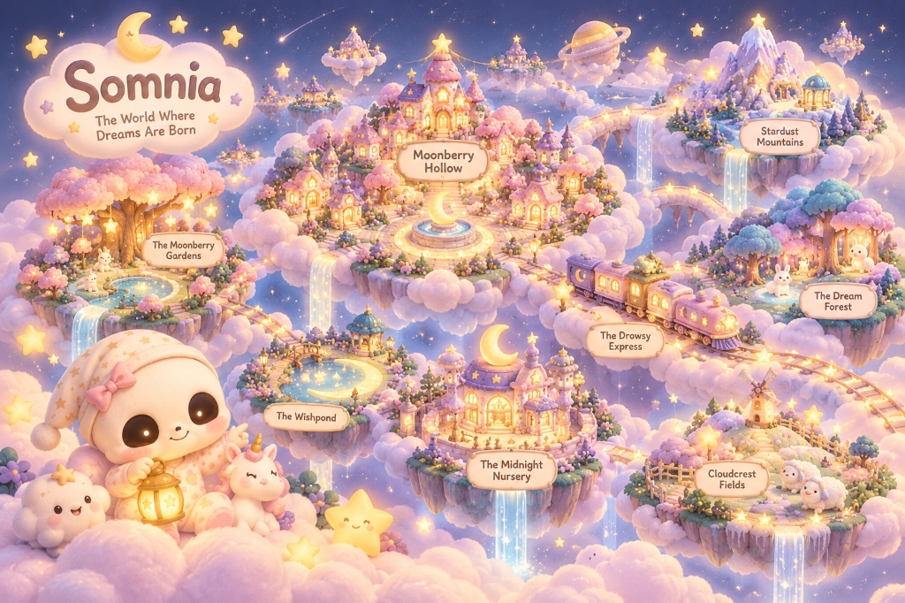
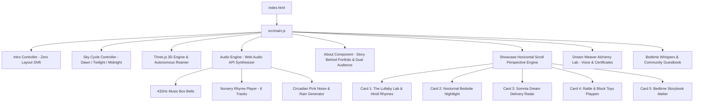

<div align="center">

  

  # 🌙 Pip’s Portfolio · Junior Dream Engineer
  ### *"I build the dreams you fall asleep inside."*

  <p align="center">
    <b>An award-grade, story-driven bedtime web haven engineered for both babies and their parents.<br/>
    Submitted to <a href="https://hax.baby">haX.baby</a> · Track 1 (Pip the Skull Baby).</b>
  </p>

  <p align="center">
    <a href="https://github.com/Tarunkush0620/Pip"></a>
    <a href="https://vitejs.dev/"></a>
    <a href="https://threejs.org/"></a>
    <a href="https://tailwindcss.com/"></a>
    
    
    
  </p>

  <p align="center">
    <a href="#-the-story-behind-this-portfolio">The Story of Pip</a> •
    <a href="#-dual-audience-haven-babies--parents">Baby & Parent Haven</a> •
    <a href="#-features-overview">Features</a> •
    <a href="#-the-lullaby-lab--rhymes-atelier">Lullaby Lab</a> •
    <a href="#-interactive-controls--shortcuts">Keyboard Shortcuts</a> •
    <a href="#-architecture--engineering">Architecture</a> •
    <a href="#-repository-structure">Directory Structure</a> •
    <a href="#-getting-started">Getting Started</a>
  </p>

  

</div>

---

## 📖 The Story Behind This Portfolio

> **Hackathon Core Requirement:** *This portfolio is not an ordinary tech resume. It is rooted entirely in an enchanted bedtime story.*

### 🌌 Prologue: The Baby from the Stardust Nebula
In the dreamlands of **Somnia**, where pastel clouds drift across lavender skies, a sleepy little baby night-spirit was born inside a glowing stardust nebula. He had a smooth, round skull face, huge glowing amber eyes, and an oversized starry nightcap. 

The elders of the sky named him **Pip**. Pip was curious, clumsy, easily delighted, giggled at the whisper of the night breeze, and above all: **he hated silence**.

### 🔭 Chapter I: The Great Earth Silence (The Bedtime Struggle)
One twilight in **Moonberry Hollow**, Pip climbed the brass ladder of the celestial clocktower and peered through his starlight telescope down at Earth.

Down below, he witnessed the universal bedtime struggle:
1. **Restless, Crying Babies**: Little ones were crying in their cribs because the night felt too dark, shadows loomed large, and the utter silence was terrifying to ears accustomed to the constant, rhythmic hum of a mother’s heartbeat.
2. **Exhausted, Overwhelmed Parents**: Mothers and fathers were pacing dark bedrooms at 2:00 AM, desperately rocking cribs, singing songs through tired yawns, and struggling to soothe their little ones without harsh overhead lights.

Pip clutched his starry cap with wide eyes:
> *“No baby should ever fear the dark, and no loving parent should have to carry bedtime all alone!”*

### 🛠️ Chapter II: How Every Portfolio Project Was Born
Pip flew down to his workbench at the **Midnight Nursery** and engineered five wondrous inventions—each built specifically to solve a bedtime struggle:

| Bedtime Struggle | Pip’s Invention | How It Solves The Need |
| :--- | :--- | :--- |
| **Babies fear cold silence** | **🎵 The Lullaby Lab** | Synthesizes pure 432 Hz music box bells matching maternal resting heart rates (60–80 BPM) to naturally calm infant nervous systems. |
| **Harsh lights ruin infant sleep** | **💡 Nocturnal Nightlights** | Hand-blown 2700K amber glow lanterns that melt scary shadows away without suppressing delicate infant melatonin. |
| **Babies fear nightmares in sleep** | **🗺️ Dream Delivery Flight Radar** | Pip flies his sky-sled over chimneys before midnight, personally slipping custom sweet dreams under every crib pillow. |
| **Restless hands & teething distress** | **🧸 Sensory Blocks & Rattle** | Tactile wooden blocks and baby rattles that build fine-motor coordination, soothe teething tension, and prompt sleepy giggles. |
| **Parents need soothing bedtime rituals** | **📖 Bedtime Storybook Atelier** | Curated storybooks and read-aloud whispers that create a predictable, bonding wind-down routine between parent and child. |

### 🧑‍🍼 Chapter III: The Sanctuary for Tired Parents
Pip understood a golden secret: **a baby cannot truly relax if their parent is anxious and exhausted**. To support parents, Pip built the **Parent Sanctuary Mode**: providing sing-along lyrics and English translations for traditional lullabies, a progressive Bedtime Sleep Timer that gently dims the room, and a fullscreen crib-side amber nightlight lamp.

---

## 👶🧑‍🍼 Dual-Audience Haven: Babies & Parents

Pip’s Portfolio features a dedicated **Audience Mode Bar** that instantly adapts the entire digital experience for both members of the bedtime family:

### 👶 1. For Babies: Sensory Delight & Motor Play
- **🪇 Pip’s Interactive Baby Rattle**: A tactile, animated rattle widget. Tapping or shaking it triggers authentic maraca bead bursts, wooden bead clacks, and prompts Pip's warm baby giggles.
- **🫧 Tap-to-Pop Stardust Bubbles**: Iridescent soap bubbles drift gently up the screen. Touching any bubble pops it with a resonant bell chime and a burst of colorful stardust confetti.
- **🐥 Squeaky Toy & Baby Giggle Loops**: Interactive sound triggers for squeaky plushies and cheerful laughter.
- **👀 Newborn Visual Filter (0–6 Months)**: Toggle high-contrast, bold outlines tailored for infants whose visual cortices are developing and respond best to high-contrast edges.
- **🛡️ Baby-Safe Tactile UI**: Oversized touch targets ($\ge 56\text{px}$) with squishy, responsive bounce feedback (`active:scale-90`) so clumsy little fingers never get frustrated.

### 🧑‍🍼 2. For Parents: Bedtime Peace & Practical Tools
- **⏱️ Bedtime Wind-Down Sleep Timer**: Presets for **10 min, 20 min, 30 min, and 45 min**. Displays a live countdown clock while automatically dimming the screen and gently fading ambient lullaby audio to zero as baby falls asleep.
- **🎶 Sing-Along Lyrics & Meanings**: Complete Hindi phonetic transliterations and heartfelt English translations for all 6 classic nursery rhymes so parents always know the words to sing along.
- **🩺 Pediatric Sleep Science Guide**: Research-backed insights explaining how 432 Hz harmonic frequencies stabilize infant heart rates and how 2700K amber lighting protects circadian rhythms.
- **💡 Fullscreen Crib-Side Screen Lamp**: Turns any phone, tablet, or monitor into a soft, breathing **Amber Honey (2700K)** or **Lavender Moon** nightlight lamp for midnight diaper changes or nursing without waking baby.

---

## ✨ Features Overview

### 🎬 1. Cinematic Edge-to-Edge Intro Experience
- **Unobtrusive Story Prologue**: A full-page, edge-to-edge video introducing Pip’s midnight universe.
- **Silent Fallback Autoplay**: Smart audio policy handling — begins smoothly without disruptive blocking overlays and unsets mute on user interaction.
- **Atmospheric HUD**: Minimalist top prologue tag and clean bottom-right CTA pill with safe-area notch insets.
- **Fluid Dissolve**: Smooth cubic-bezier zoom and blur transition welcoming the visitor directly into the nursery.

### ☀️/🌅/🌌 2. Tri-Phase Celestial Sky Cycle Engine
- **Live Atmosphere Cycling**: Dynamically blend between **Dawn (06:00 ☀️)**, **Twilight (19:30 🌅)**, and **Midnight (23:45 🌌)**.
- **Dual Synced Video Backgrounds**: High-definition sky video loops (`Dawn.mp4` and `midnight.mp4`) with synchronized CSS brightness, saturation, and contrast filters.
- **Lighting Atmosphere HUD**: Slide-out drawer with celestial time slider, starlight density telemetry, and active hue syncing for lamps and lanterns.
- **Shooting Star Mechanics**: Press `S` or tap the button to summon animated shooting stars across the cosmic sky.

### 📖 3. Interactive Story Journey (5 Illustrated Chapters)
- **Living Storybook Stage**: Read Pip’s complete origin saga across 5 chapters with artwork, bedtime whisper quotes, and dual baby/parent perspectives.
- **Read Chapter to Me**: Automated voice narration via Web Speech API with gentle bedtime cadence and musical chime accompaniment.
- **Story-to-Invention Bridges**: Direct CTA buttons that link each story chapter to the corresponding invention in Pip’s workshop.

### 🎵 4. The Lullaby Lab & Hindi Nursery Rhymes Player
- **Clockwork Music Box**: An interactive audio atelier designed to comfort little dreamers.
- **6 Rich Bedtime Melodies**: Loaded with 5 classic Hindi nursery rhymes plus Pip's signature 432 Hz synthesized music box chimes.
- **Real-Time Spectrum Visualizer**: Animated sound waveform bars synchronized with music playback.
- **Interactive Winding Key**: Wind the music box to trigger rotational animations, floating musical notes (`♪ ♫ ♩ ✨`), and soothing harmonics.

### 💡 5. Nocturnal Nightlight & Bedside Chamber
- **Dynamic Bedtime Dimmer**: Switch Pip’s crescent moon lantern on or off; blowing out the lantern casts deep ambient darkness over the nursery.
- **Atmosphere Vignette**: Soft radial warm candle flicker that creates a cozy bedtime environment.

### 🗺️ 6. Somnia Dream Delivery Radar
- **Live Flight Map**: Real-time canvas radar mapping Pip’s airborne flight path over rooftops, chimneys, and cloud lanes.
- **Flight Diagnostics**: Altitude meters, cloud density telemetry, and dream cargo counts.

### 🧸 7. Physics Block Stacking Playpen
- **Interactive Toy Stack**: Click or tap to stack Pip's colorful rattle blocks.
- **Pop-to-Clear**: Tap individual blocks to burst them into stardust particles.

### 📖 8. Bedtime Storybook Atelier
- **Illustrated Bedtime Stories**: Cozy bedtime tales written and illustrated by Pip (*"Pip & The Sleepy Star"*, *"Mom's Hands"*, *"The Owl Who Stopped Pretending"*).
- **Interactive Page Flip**: 3D paper-turning physics with dynamic shadow drops and chapter bookmarks.
- **Voice Narration**: Word-by-word stardust highlighting powered by Web Speech API.

### 🔮 9. The Dream Weaver Alchemy Lab
- **Bedtime Ingredient Pantry**: Combine soothing dream ingredients (e.g., *Cloud Fluff*, *Moonbeam Honey*, *Lavender Breeze*, *Starlight Kitten*).
- **Official Bedtime Certificate**: Generates a numbered, 100% nightmare-proof dream card with high-contrast typography in both Dawn and Midnight modes.
- **Interactive Actions**: Read Dream Aloud (Speech Synthesis), Save/Print Bedtime Certificate, and 1-click share to the Community Whispers Guestbook.

### 📱 10. 100% Responsive Mobile Architecture
- **Mobile Navigation Drawer**: Clean glassmorphism drawer accessible via a top hamburger button.
- **Touch Swipe Horizontal Gallery**: Touch-friction swipe controls for invention cards with `100dvh` viewport adaptation.
- **Zero Horizontal Blowout**: Strict responsive typography from 320px screens up to 4K displays.

---

## 🎶 The Lullaby Lab & Rhymes Atelier

| # | Song Title | Hindi Title | Engine | Pediatric Sleep Benefit & Mood |
| :-: | :--- | :--- | :-: | :--- |
| **1** | **Lakdi Ki Kathi** | लकड़ी की काठी | High-Bitrate Studio MP3 | Joyful rhythm to tire out energetic toddler legs before bath |
| **2** | **Chanda Mama Door Ke** | चंदा मामा दूर के | High-Bitrate Studio MP3 | Slow pentatonic cadence matching infant sleep respiratory rate |
| **3** | **Nani Teri Morni** | नानी तेरी मोरनी | High-Bitrate Studio MP3 | Storytelling rhyme stimulating early phoneme recognition |
| **4** | **Lalla Lalla Lori** | लल्ला लल्ला लोरी | High-Bitrate Studio MP3 | Soft "L" and "M" phonemes acting as biological pacifiers |
| **5** | **Twinkle Twinkle Little Star** | ट्विंकल ट्विंकल | High-Bitrate Studio MP3 | Timeless reassuring melody that eases bedtime separation anxiety |
| **6** | **Pip’s Music Box** | 432 Hz Synth Bells | Web Audio API Oscillator | Pure mathematical sine oscillators inducing delta brainwaves |

---

## 🎮 Interactive Controls & Shortcuts

| Key / Action | Context | Effect |
| :--- | :--- | :--- |
| <kbd>Space</kbd> / <kbd>K</kbd> | Anywhere | Play / Pause active lullaby audio or intro |
| <kbd>M</kbd> | Anywhere | Mute / Unmute ambient soundscapes |
| <kbd>S</kbd> | Anywhere | **Summon a shooting star** across the celestial sky 🌠 |
| <kbd>Esc</kbd> | Intro Mode | Skip intro and immediately enter the nursery |
| <kbd>←</kbd> / <kbd>→</kbd> | Inventions | Navigate between Pip's 5 invention cards |
| **Tap Mode Pill** | Header / Haven | Switch between **👶 Baby Mode** and **🧑‍🍼 Parent Mode** |
| **Tap Baby Rattle** | Baby Haven | Shake the rattle with real sound & trigger Pip's giggle |
| **Tap Bubble Garden** | Baby Haven | Spawn and pop stardust bubbles with harmonic bells |
| **Tap Pip's Avatar** | Hero Section | Hear Pip's authentic baby greeting bubble 🧸 |
| **Tap Dream Orb** | Dream Weaver | Pulse stardust glow and hear Pip's slumber giggle |
| **Tap Lantern** | Invention #2 | Toggle bedroom nightlight on / off |
| **Drag / Touch Swipe** | Showcase | Smooth 3D perspective horizontal gallery slide |

---

## 🏛️ Architecture & Engineering



### 1. Zero-Bloat Vanilla JavaScript Architecture
Built with modular ES6 modules and modern Vite bundler. Zero heavy framework bloat ensures **steady 60–120 FPS performance** across mobile phones, tablets, and desktop browsers.

### 2. Procedural Web Audio Engine (`src/audio/soundEffects.js`)
- **Sine-Wave Bell Synthesizer**: Implements dual-oscillator harmonic overtone synthesis (`freq * 3.01`) with exponential decay ramps for authentic musical box metallics.
- **Procedural Baby & Nursery Sounds**:
  - `playBlockPop()`: Dual upward glissando oscillators with stardust ring resonance.
  - `playBlockDrop()`: Musical wooden block placement with physical bounce harmonics.
  - `playPipGiggle()`: Sequence of warm pentatonic bell giggles.
- **Circadian Pink Noise & Rain**: Procedural pink noise filtered at 380 Hz to soothe infant sleep.

### 3. Spatial 3D Perspective Stage
- Horizontal gallery driven by requestAnimationFrame (RAF) inertia smoothing (lerp factor `0.16`).
- Cards dynamically scale, rotate, and fade along the Z-axis based on viewport distance.

---

## 📁 Repository Structure

```
Pip/
├── public/                         # Production static assets
│   ├── assets/
│   │   ├── audio/                  # Mastered nursery rhymes (MP3)
│   │   ├── images/                 # Studio renders, storybooks & maps
│   │   └── videos/                 # Atmosphere loops & intro (MP4)
│   ├── favicon.svg                 # Nursery starlight favicon
│   └── intro.mp4                   # Full-screen opening video
├── src/                            # Modular application source code
│   ├── audio/                      # Web Audio API sound synthesis
│   │   └── soundEffects.js         # Bells, rattles, pops, rain & noise
│   ├── components/                 # Reusable UI component views
│   │   ├── About.js                # Character dossier, Story & Dual Audience
│   │   ├── DreamWeaver.js          # Interactive dream laboratory & certificates
│   │   ├── Footer.js               # Bedtime countdown & quiet ward
│   │   ├── GrowthChart.js          # Nursery wall skills tracker
│   │   ├── Guestbook.js            # Dreamers community guestbook
│   │   ├── Hero.js                 # Headline, stats, CTAs & Pip avatar
│   │   ├── Intro.js                # Cinematic full-page intro overlay
│   │   ├── Marquee.js              # Playful scrolling ribbon
│   │   ├── Navbar.js               # Floating dock & mobile drawer
│   │   ├── Showcase.js             # 5 Inventions gallery & music player
│   │   └── WorldLore.js            # Somnia atlas & interactive lore
│   ├── data/                       # Datasets for worlds & storybooks
│   │   ├── storybookData.js
│   │   └── worldData.js
│   ├── scripts/                    # Interactive controllers & game logic
│   │   ├── atmosphericEngine.js
│   │   ├── blocksGame.js
│   │   ├── deliveryMap.js
│   │   ├── dreamGenerator.js       # Ingredient alchemy, speech & certificate engine
│   │   ├── horizontalScroll.js
│   │   ├── introController.js
│   │   ├── skyCycleController.js
│   │   ├── statsCounter.js
│   │   ├── storybookController.js
│   │   └── worldLoreController.js
│   ├── styles/                     # Tailwind CSS & custom design tokens
│   │   └── main.css
│   ├── three/                      # Three.js 3D character & scene logic
│   │   ├── pipAutonomous3DRoamer.js
│   │   ├── pipCharacter3D.js
│   │   └── scene.js
│   └── main.js                     # Application bootstrap & assembly
├── docs/                           # Project specifications
│   └── Pip_Brief.md                # Hackathon character prompt & requirements
├── prototypes/                     # Standalone legacy prototypes
│   ├── Pip_Portfolio.html          # Original single-file prototype
│   └── pip-3d-character.html       # Three.js experimental canvas
├── raw_media/                      # Creator pack & media archive
│   ├── creator_pack/               # Official studio assets & renders
│   ├── original_audio/             # Raw source audio downloads
│   └── original_videos/            # Raw source videos
├── index.html                      # Root HTML entry point
├── package.json                    # Project metadata & dependencies
├── vite.config.js                  # Vite configuration
└── README.md                       # Comprehensive documentation
```

---

## 🚀 Getting Started

### Prerequisites
Make sure you have [Node.js](https://nodejs.org/) (v18 or higher) installed on your system.

### 1. Clone the Repository
```bash
git clone https://github.com/Tarunkush0620/Pip.git
cd Pip
```

### 2. Install Dependencies
```bash
npm install
```

### 3. Run the Development Server
```bash
npm run dev
```
Open your browser and navigate to **`http://localhost:5173`**.

### 4. Build for Production
```bash
npm run build
```
The optimized production bundle will be generated in the `dist/` folder.

### 5. Preview Production Build
```bash
npm run preview
```

---

## 🎨 Design System & Color Palette

| Color Token | Hex Code | Preview | Purpose |
| :--- | :---: | :---: | :--- |
| **Berry** | `#FF75A0` | `■` | Primary brand accent & interactive buttons |
| **Berry Dark** | `#E62A6B` | `■` | Active states & high-contrast highlights |
| **Blush** | `#FBDCE6` | `■` | Soft background glow & cloud borders |
| **Moon** | `#FCE183` | `■` | Stardust accents, badges & countdown timers |
| **Deep Velvet** | `#160822` | `■` | Midnight sky base background |
| **Lavender** | `#CDB8E3` | `■` | Secondary typography & celestial borders |

- **Primary Headings**: *Fredoka* (Google Fonts)
- **Body & Technical UI**: *Outfit* (Google Fonts)

---

## 🏆 Hackathon Submission Details

- **Event**: [haX.baby — Baby's First Website](https://hax.baby)
- **Track**: **Track 1: Pip the Skull Baby**
- **Core Theme**: A living storybook portfolio solving the bedtime struggle for babies and their parents.
- **Creator Pack**: Watermark-free studio renders provided by the official creator asset pack.
- **Repository**: [https://github.com/Tarunkush0620/Pip](https://github.com/Tarunkush0620/Pip)
- **Author**: Tarun ([@Tarunkush0620](https://github.com/Tarunkush0620))

---

<div align="center">
  <b>Created with ✨ and stardust for babies and parents everywhere. Sweet dreams! 🌙</b>
</div>
