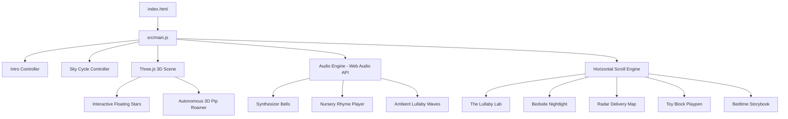

<div align="center">

  

  # 🌙 Pip’s Portfolio · Junior Dream Engineer
  ### *"I build the dreams you fall asleep inside."*

  <p align="center">
    <b>An award-grade, interactive, story-driven web experience built for <a href="https://hax.baby">haX.baby</a> · Track 1 (Pip the Skull Baby).</b>
  </p>

  <p align="center">
    <a href="https://github.com/Tarunkush0620/Pip"></a>
    <a href="https://vitejs.dev/"></a>
    <a href="https://threejs.org/"></a>
    <a href="https://tailwindcss.com/"></a>
    
    
  </p>

  <p align="center">
    <a href="#-features-overview">Features</a> •
    <a href="#-the-lullaby-lab--rhymes-atelier">Lullaby Lab</a> •
    <a href="#-interactive-controls--shortcuts">Keyboard Shortcuts</a> •
    <a href="#-architecture--engineering">Architecture</a> •
    <a href="#-repository-structure">Directory Structure</a> •
    <a href="#-getting-started">Getting Started</a>
  </p>

  

</div>

---

## 📖 The Story of Pip

**Pip** is a curious, sleepy, and wonderfully clumsy baby with a smooth round skull face, glowing starlight eyes, and a magical nightcap. Stationed at the **Midnight Nursery**, Pip’s nightly mission is to invent sweet dreams, craft soothing lullabies, and fly across rooftop chimneys delivering peaceful slumber to all the little ghosts, bears, and creatures across **Somnia**.

This portfolio is Pip’s official workbench, laboratory, and bedtime atelier.

---

## ✨ Features Overview

### 🎬 1. Cinematic Edge-to-Edge Intro Experience
- **Unobtrusive Story Prologue**: A full-page, edge-to-edge video introducing Pip’s midnight universe.
- **Silent Fallback Autoplay**: Smart audio policy handling — begins smoothly without disruptive blocking overlays and unsets mute on user interaction.
- **Atmospheric HUD**: Minimalist top prologue tag and clean bottom-right CTA pill with safe-area notch insets.
- **Fluid Dissolve**: Smooth cubic-bezier zoom and blur transition welcoming the visitor directly into the nursery.

### ☀️/🌅/🌌 2. Tri-Phase Celestial Sky Cycle Engine
- **Live Atmosphere Cycling**: Dynamically blend between **Dawn (06:00 ☀️)**, **Twilight (19:30 🌅)**, and **Midnight (23:45 🌌)**.
- **Dual Synced Video Backgrounds**: High-definition sky video loops (`Dawn.mp4` and `midnight.mp4`) with synchronized CSS brightness, saturation, and contrast filters.
- **Lighting Atmosphere HUD**: Slide-out drawer with celestial time slider, starlight density telemetry, and active hue syncing for lamps and lanterns.
- **Shooting Star Mechanics**: Press `S` or tap the button to summon animated shooting stars across the cosmic sky.

### 🎵 3. The Lullaby Lab & Hindi Nursery Rhymes Player
- **Clockwork Music Box**: An interactive audio atelier designed to comfort little dreamers.
- **6 Rich Bedtime Melodies**: Loaded with 5 classic Hindi nursery rhymes plus Pip's signature 432 Hz synthesized music box chimes.
- **Real-Time Spectrum Visualizer**: Animated sound waveform bars synchronized with music playback.
- **Interactive Winding Key**: Wind the music box to trigger rotational animations, floating musical notes (`♪ ♫ ♩ ✨`), and soothing harmonics.

### 💡 4. Nocturnal Nightlight & Bedside Chamber
- **Dynamic Bedtime Dimmer**: Switch Pip’s crescent moon lantern on or off; blowing out the lantern casts deep ambient darkness over the nursery.
- **Atmosphere Vignette**: Soft radial warm candle flicker that creates a cozy bedtime environment.

### 🗺️ 5. Somnia Dream Delivery Radar
- **Live Flight Map**: Real-time canvas radar mapping Pip’s airborne flight path over rooftops, chimneys, and cloud lanes.
- **Flight Diagnostics**: Altitude meters, cloud density telemetry, and dream cargo counts.

### 🧸 6. Physics Block Stacking Playpen
- **Interactive Toy Stack**: Click or tap to stack Pip's colorful rattle blocks.
- **Pop-to-Clear**: Tap individual blocks to burst them into stardust particles.

### 📖 7. Bedtime Storybook Atelier
- **Illustrated Bedtime Stories**: Cozy bedtime tales written and illustrated by Pip (*"The Bear Who Dreamed in Vanilla"*, *"The Star That Forgot How to Shimmer"*).
- **Interactive Page Flip**: Seamless chapter reader with bookmark progress.

### 🔮 8. The Dream Weaver Alchemy Lab
- **Bedtime Ingredient Pantry**: Combine soothing dream ingredients (e.g., *Warm Honey Clouds*, *Cinnamon Stardust*, *Velvet Moonbeams*).
- **Certificate Generator**: Generates an official, numbered, 100% nightmare-proof Bedtime Dream Certificate.

### 📱 9. 100% Responsive Mobile Architecture
- **Mobile Navigation Drawer**: Clean glassmorphism drawer accessible via a top hamburger button.
- **Touch Swipe Horizontal Gallery**: Touch-friction swipe controls for invention cards with `100dvh` viewport adaptation.
- **Zero Horizontal Blowout**: Strict responsive typography from 320px screens up to 4K displays.

---

## 🎶 The Lullaby Lab & Rhymes Atelier

| # | Song Title | Hindi Title | Engine | Mood & Theme |
| :-: | :--- | :--- | :-: | :--- |
| **1** | **Lakdi Ki Kathi** | लकड़ी की काठी | High-Bitrate Studio MP3 | Beloved playful classic rhythm |
| **2** | **Nani Teri Morni** | नानी तेरी मोरनी | High-Bitrate Studio MP3 | Forest folk bedtime tale |
| **3** | **Aalu Kachalu** | आलू कचालू बेटा | High-Bitrate Studio MP3 | Cheerful nursery memory |
| **4** | **Aaha Tamatar** | आहा टमाटर बड़े मजेदार | High-Bitrate Studio MP3 | Joyful sweet dream tune |
| **5** | **Ek Mota Hathi** | एक मोटा हाथी | High-Bitrate Studio MP3 | Whimsical spider-web story |
| **6** | **Brahms Celestial** | 432Hz Synth Chimes | Web Audio API Oscillator | Real-time pure sine-wave bell chimes |

---

## 🎮 Interactive Controls & Shortcuts

| Key / Action | Context | Effect |
| :--- | :--- | :--- |
| <kbd>Space</kbd> / <kbd>K</kbd> | Anywhere | Play / Pause active lullaby audio or intro |
| <kbd>M</kbd> | Anywhere | Mute / Unmute ambient soundscapes |
| <kbd>S</kbd> | Anywhere | **Summon a shooting star** across the celestial sky 🌠 |
| <kbd>Esc</kbd> | Intro Mode | Skip intro and immediately enter the nursery |
| <kbd>←</kbd> / <kbd>→</kbd> | Inventions | Navigate between Pip's 5 invention cards |
| **Tap Pip's Avatar** | Hero Section | Hear Pip's authentic baby greeting bubble 🧸 |
| **Tap Lantern** | Invention #2 | Toggle bedroom nightlight on / off |
| **Drag / Touch Swipe** | Showcase | Smooth 3D perspective horizontal gallery slide |

---

## 🏛️ Architecture & Engineering



### 1. Zero-Bloat Component Architecture
Built entirely with clean, modern Vanilla JavaScript modules. No unnecessary heavy framework overhead — ensuring **60–120 FPS performance** even on budget mobile devices.

### 2. Audio Engine (`soundEffects.js`)
- Combines the native **Web Audio API** (`AudioContext`, `OscillatorNode`, `GainNode`) for real-time mathematical chime synthesis with an optimized HTML5 audio track player for nursery rhymes.
- Implements exponential gain ramp releases for authentic acoustic bell resonance.

### 3. Spatial 3D Perspective Stage
- Horizontal gallery driven by requestAnimationFrame (RAF) inertia smoothing (lerp factor `0.16`).
- Cards dynamically scale, rotate, and fade along the Z-axis based on viewport distance.

---

## 📁 Repository Structure

```
Pip/
├── public/                         # Production static assets
│   ├── assets/
│   │   ├── audio/                  # Mastered nursery rhymes (MP3)
│   │   ├── images/                 # Studio renders, storybooks & maps
│   │   └── videos/                 # Atmosphere loops & intro (MP4)
│   ├── favicon.svg                 # Nursery starlight favicon
│   └── intro.mp4                   # Full-screen opening video
├── src/                            # Modular application source code
│   ├── audio/                      # Web Audio API sound synthesis
│   │   └── soundEffects.js
│   ├── components/                 # Reusable UI component views
│   │   ├── About.js                # Character dossier & story
│   │   ├── DreamWeaver.js          # Interactive dream laboratory
│   │   ├── Footer.js               # Bedtime countdown & nightcap
│   │   ├── GrowthChart.js          # Nursery wall skills tracker
│   │   ├── Guestbook.js            # Dreamers guestbook
│   │   ├── Hero.js                 # Headline, stats & Pip avatar
│   │   ├── Intro.js                # Cinematic full-page intro overlay
│   │   ├── Marquee.js              # Playful scrolling ribbon
│   │   ├── Navbar.js               # Floating dock & mobile drawer
│   │   ├── Showcase.js             # 5 Inventions gallery & music player
│   │   └── WorldLore.js            # Somnia atlas & interactive lore
│   ├── data/                       # Datasets for worlds & storybooks
│   │   ├── storybookData.js
│   │   └── worldData.js
│   ├── scripts/                    # Interactive controllers & game logic
│   │   ├── atmosphericEngine.js
│   │   ├── blocksGame.js
│   │   ├── deliveryMap.js
│   │   ├── dreamGenerator.js
│   │   ├── horizontalScroll.js
│   │   ├── introController.js
│   │   ├── skyCycleController.js
│   │   ├── statsCounter.js
│   │   └── storybookController.js
│   ├── styles/                     # Tailwind CSS & custom design tokens
│   │   └── main.css
│   ├── three/                      # Three.js 3D character & scene logic
│   │   ├── pipAutonomous3DRoamer.js
│   │   ├── pipCharacter3D.js
│   │   └── scene.js
│   └── main.js                     # Application bootstrap & assembly
├── docs/                           # Project specifications
│   └── Pip_Brief.md                # Hackathon character prompt & requirements
├── prototypes/                     # Standalone legacy prototypes
│   ├── Pip_Portfolio.html          # Original single-file prototype
│   └── pip-3d-character.html       # Three.js experimental canvas
├── raw_media/                      # Creator pack & media archive
│   ├── creator_pack/               # Official studio assets & renders
│   ├── original_audio/             # Raw source audio downloads
│   └── original_videos/            # Raw source videos
├── index.html                      # Root HTML entry point
├── package.json                    # Project metadata & dependencies
├── vite.config.js                  # Vite configuration
└── README.md                       # Comprehensive documentation
```

---

## 🚀 Getting Started

### Prerequisites
Make sure you have [Node.js](https://nodejs.org/) (v18 or higher) installed on your system.

### 1. Clone the Repository
```bash
git clone https://github.com/Tarunkush0620/Pip.git
cd Pip
```

### 2. Install Dependencies
```bash
npm install
```

### 3. Run the Development Server
```bash
npm run dev
```
Open your browser and navigate to **`http://localhost:5173`**.

### 4. Build for Production
```bash
npm run build
```
The optimized production bundle will be generated in the `dist/` folder.

### 5. Preview Production Build
```bash
npm run preview
```

---

## 🎨 Design System & Color Palette

| Color Token | Hex Code | Preview | Purpose |
| :--- | :---: | :---: | :--- |
| **Berry** | `#FF75A0` | `■` | Primary brand accent & interactive buttons |
| **Berry Dark** | `#E62A6B` | `■` | Active states & high-contrast highlights |
| **Blush** | `#FBDCE6` | `■` | Soft background glow & cloud borders |
| **Moon** | `#FCE183` | `■` | Stardust accents, badges & countdown timers |
| **Deep Velvet** | `#160822` | `■` | Midnight sky base background |
| **Lavender** | `#CDB8E3` | `■` | Secondary typography & celestial borders |

- **Primary Headings**: *Fredoka* (Google Fonts)
- **Body & Technical UI**: *Outfit* (Google Fonts)

---

## 🏆 Hackathon Submission Details

- **Event**: [haX.baby — Baby's First Website](https://hax.baby)
- **Track**: **Track 1: Pip the Skull Baby**
- **Creator Pack**: Watermark-free studio renders provided by the official creator asset pack.
- **Repository**: [https://github.com/Tarunkush0620/Pip](https://github.com/Tarunkush0620/Pip)
- **Author**: Tarun ([@Tarunkush0620](https://github.com/Tarunkush0620))

---

<div align="center">
  <b>Created with ✨ and stardust for dreamers everywhere. Sweet dreams! 🌙</b>
</div>
